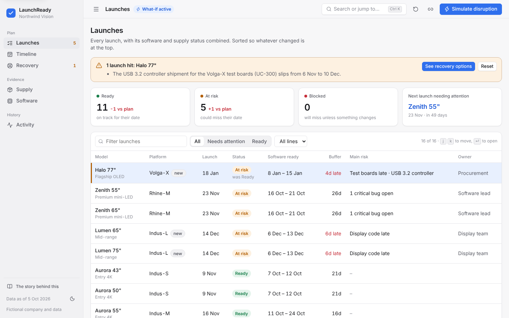
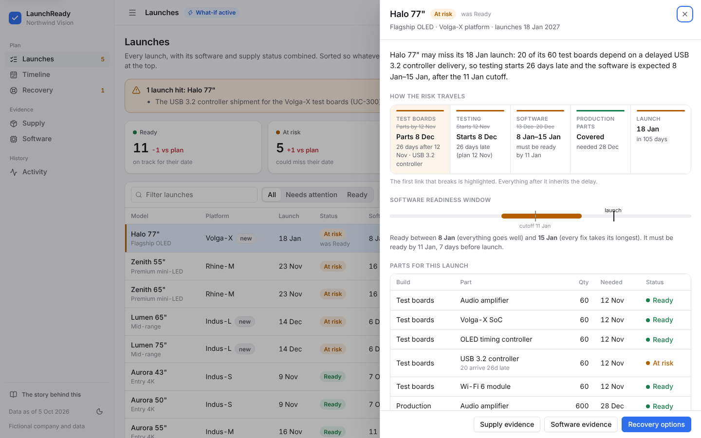
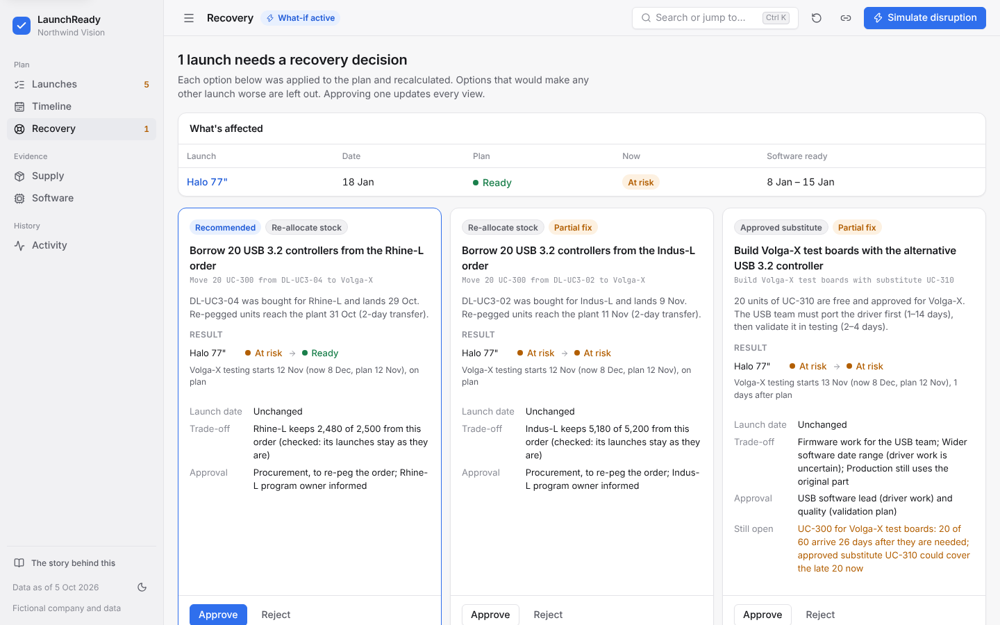
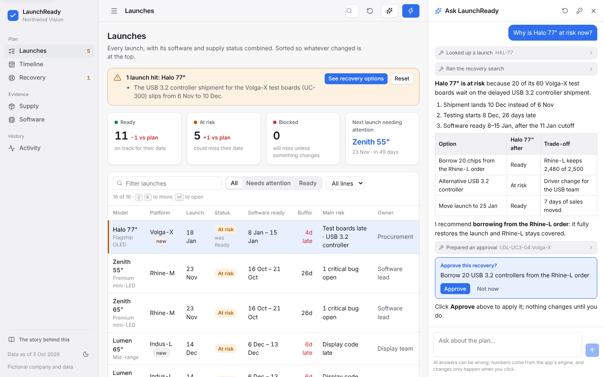
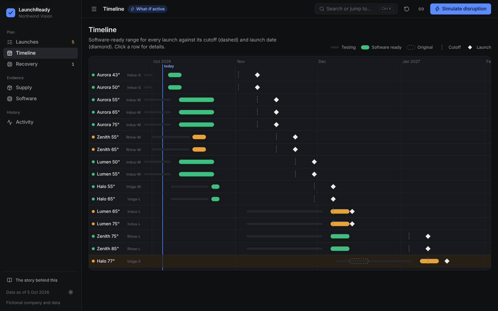
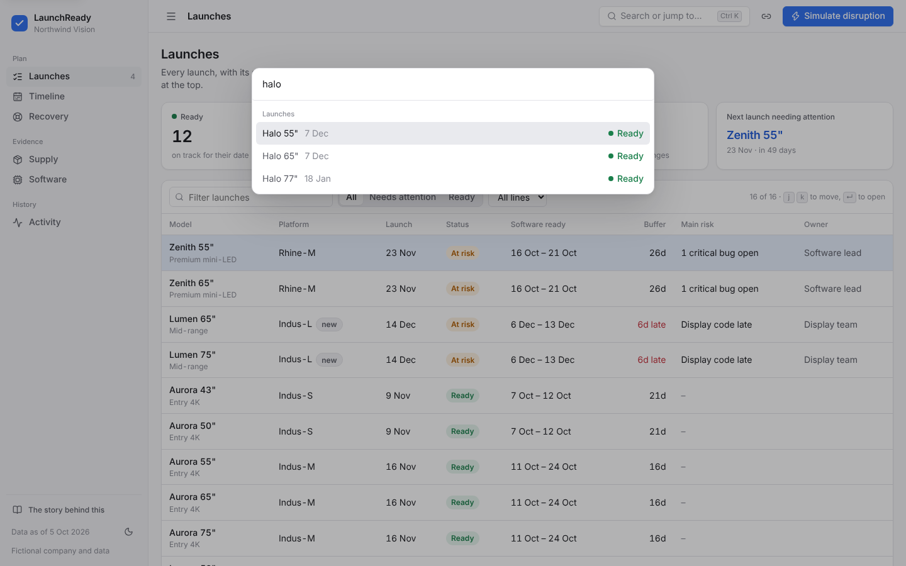

# LaunchReady

[](https://github.com/hemant-singla/launchready/actions/workflows/ci.yml)

**When a supplier slips, which TV launches break, why, and what's the best way to recover?**

LaunchReady joins the two halves of a TV launch that usually live in different tools: **software readiness** (code submissions, test cycles, bug backlogs) and **parts supply** (stock, supplier shipments, allocation). The key link is that *test boards need parts*. A late shipment of a cheap chip can delay testing, which delays the software, which misses a launch two months later. LaunchReady computes that chain for every launch and tests the ways to recover before it shows them.

**Live:** https://hemant-singla.github.io/launchready/ · **Product brief:** [docs/PRODUCT_BRIEF.md](docs/PRODUCT_BRIEF.md) · **Architecture:** [docs/ARCHITECTURE.md](docs/ARCHITECTURE.md)

> Portfolio project by [Hemant Singla](https://hemant-singla.github.io). **Fictional company (Northwind Vision) and data.** It has no real users and claims no savings. Every date and quantity shown is calculated by the code in this repo.



## What you can do

| | |
|---|---|
| **See every launch at once.** One status per launch, the worse of software and supply, with buffer days, the main risk and who owns the fix. Whatever changed sorts to the top. | **Simulate a disruption** (press `S`). Delay any shipment, fail it at inspection, lose its date, or move a launch. Preview the impact before applying it. |
| **Follow the chain.** Each launch opens a drawer with a plain-language explanation and the dependency chain (test boards → testing → software → production parts → launch), with the first broken link highlighted. | **Recover.** Options are applied to a copy of the plan and recalculated against all 16 launches. Anything that would hurt another launch is ruled out. Approve, reject, or undo. |
| **Share the exact view.** The disruption and approved actions live in the URL, so a link reopens the same state. | **Keyboard first.** `⌘K` command palette, `S` simulate, `A` ask AI, `1`–`6` switch views, `j`/`k` and `↵` in tables, `/` filter, `Esc` closes. Dark mode follows the system. |
| **Ask in plain language** (press `A`). An AI assistant answers questions about the plan by calling tools over the live workspace, so every number comes from the engine. It can set up a what-if or a recovery approval, which you apply with a click. **Free mode** answers common questions with no AI and no cost; Claude handles open-ended ones when connected. See [docs/ASSISTANT.md](docs/ASSISTANT.md). | |

| Launch detail | Recovery |
|---|---|
|  |  |



| Timeline (dark mode) | Command palette |
|---|---|
|  |  |

The start page tells the problem as a story, with every number computed by the same engine, and compares the approach with how large TV makers handle this today (public information only): see [docs/LANDSCAPE.md](docs/LANDSCAPE.md).

## How the verdict is calculated

- **Software (per chip platform):** testing starts at the latest of the planned start, code complete + 3 days of bring-up, and test boards available. The ready date is a **range**: the later of (test window + stabilisation) and (open-ticket fix days ÷ team capacity), at the optimistic and pessimistic ends. *Ready* when the latest date is at least 7 days before launch with no late code and no open critical bugs; *Blocked* when even the earliest date is after launch.
- **Supply (per launch):** parts are allocated in need-date order (test boards first on a tie), each unit once. Orders bought for a platform go to it first. Rejected and undated shipments never count. Late, tight, substitute-dependent or undated coverage is *At risk*; uncovered parts, or production parts more than 7 days late, are *Blocked*.
- **Launch:** the worse of the two, with reasons from both. Every threshold is in [`data/config.json`](data/config.json).

## Recovery

`src/engine/recovery.ts` generates only the actions the data supports, applies each to a copy of the plan, recalculates everything, and drops any that don't help or that make another launch worse:

- **Re-allocate an order** bought for another program (same part only), with a 2-day transfer. The other program keeps the rest, and that's checked.
- **Approved substitute** for test boards, if free stock covers the whole gap. Adds the driver change before testing (1–14 days) and validation inside testing (2–4 days).
- **Move the launch** to the earliest date that restores the original verdict, up to 42 days.

Options are ranked by launches restored, then by how disruptive the action is, then by the earliest software date. When nothing fully resolves a launch, the view says what to escalate. The search is deterministic and fully tested; it is not an AI.

## Architecture in brief

```
data/*.json ──► src/engine (pure TypeScript, no UI) ──► src/app (React views)
                     ▲                                   │
                     ├──── tests/ (Vitest)               └── e2e/ (Playwright)
                     ├──── src/agent/runAssistantTool.ts (in-app assistant's tools, same engine)
                     └──── src/agent/tools.ts (offline agent script's tools)
```

- **Engine** (`src/engine`): pure functions over plain data, so the app, the unit tests and the AI agent tools all compute the same numbers. No React, no I/O.
- **App** (`src/app`): React 19 + TypeScript, built with Vite. Workspace state (disruptions + approved actions) is a reducer whose shareable part is encoded into the URL. Derived results are memoised; the recovery search runs only where it's shown and is cached.
- **Assistant** (`src/agent`, `src/app/assistant`, `proxy/`): Claude with ten strict tools that run in the browser over the live workspace; a streaming tool loop; a Cloudflare Worker that holds the key and rebuilds every request. Details: [docs/ASSISTANT.md](docs/ASSISTANT.md).
- **Quality:** strict TypeScript, ESLint, 57 unit tests (engine, assistant tools, free mode, loop, proxy), 12 Playwright end-to-end tests (desktop + phone, including the assistant with scripted streams), and GitHub Actions on every push. `main` deploys to GitHub Pages after all checks pass.

Details and trade-offs: [docs/ARCHITECTURE.md](docs/ARCHITECTURE.md) and the decision records in [docs/adr/](docs/adr/).

## Run it

Requires Node 22+.

```bash
npm install
npm run dev            # http://localhost:5173
npm run check          # typecheck + lint + unit tests
npm run test:e2e       # Playwright (first time: npx playwright install chromium)
npm run build          # production build in dist/
```

Other scripts: `npm run data:generate` rebuilds the fictional dataset, `npm run data:overview` regenerates [docs/DATA.md](docs/DATA.md), and `ANTHROPIC_API_KEY=... npm run agent` records a real Claude agent run over the same tools (costs API credits; no runs are recorded yet).

## Project layout

```
src/engine/   readiness engine: supply allocation, software ETA, recovery, what-if
src/app/      React app: state/, pages/, components/, story/, lib/
src/agent/    the assistant: prompt, tools, tool runner, streaming loop
proxy/        Cloudflare Worker that holds the API key for the assistant
tests/        unit tests (Vitest)            e2e/   browser tests (Playwright)
data/         fictional dataset (JSON)        docs/  brief, architecture, ADRs, landscape
scripts/      data generation, data overview, agent runner
```

## Honest limitations

- Fictional data; the baseline was designed so the scenarios show clear effects.
- No real integrations (issue tracker, ERP, supplier portals). Data quality is assumed.
- Simplified model: key parts only, one flat transfer time, no test-lab capacity, no costs or expediting.
- The rules (buffers, fix-time ranges, allocation order) are reasonable defaults, not validated ones.
- Recovery options are single actions; approve one and the search re-checks what's left.
- Decisions live in the page link and this browser session; there's no shared backend.
- The assistant's wording comes from a model and can be wrong; its numbers come from tools, which the panel shows. Its tests use scripted responses, not the live API.

More in the [product brief](docs/PRODUCT_BRIEF.md) §8.
