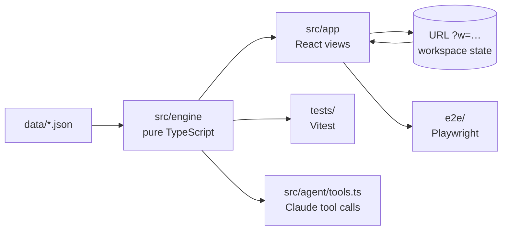

# Architecture

LaunchReady is a client-side TypeScript application. A pure engine computes every verdict from a JSON dataset; a React app renders it and holds the user's what-if state. There is no backend: the site is static and served by GitHub Pages.



## Layers

| Layer | Path | Responsibility | Depends on |
|---|---|---|---|
| Data | `data/*.json` | Fictional plan: models, chip platforms, teams, tickets, parts, stock, deliveries, substitutes, thresholds | nothing |
| Engine | `src/engine/` | All business logic, as pure functions over plain data | data types only |
| App | `src/app/` | Views, interaction, workspace state, URL sync | engine |
| Agent tools | `src/agent/tools.ts` | JSON-schema tools for a Claude agent; thin wrappers over the engine | engine |

The engine never imports from the app. That boundary is what lets the same numbers appear in the UI, the tests and an agent's tool results.

## Engine (`src/engine`)

| Module | What it does |
|---|---|
| `types.ts` | Domain types for the dataset and every derived result. |
| `supply.ts` | `allocate()`: builds demand lines (test boards per platform, production per model, one per part), sorts them by need date, and hands out stock and dated deliveries once each. Pegged orders go to their platform first. A second pass finds approved substitutes in what's left. Undated deliveries are reported, never counted. |
| `software.ts` | `softwareEta()`: test start = latest of plan, code complete + bring-up, boards ready. Ready range = max(test window + stabilisation, backlog ÷ capacity), at both ends. `softwareStatus()` turns that into a verdict against the 7-day cutoff. |
| `compute.ts` | `computeAll()`: joins the two sides. Test-board readiness from supply feeds the software ETA, which is how a parts delay becomes a software delay. Each model's status is the worse side. |
| `recovery.ts` | `recoveryOptions()`: what got worse vs the original plan, the eligible actions, each tested by re-running `computeAll` on a copy, filtered (must help, must not hurt others) and ranked. `applyActions()` applies approved actions. |
| `lab.ts` | What-if edits (`applyLab`), the knock-on trail, and `explain()`: one plain sentence per launch built from computed values. |
| `scenarios.ts`, `substitute.ts`, `decisions.ts`, `dates.ts`, `data.ts` | Preset disruptions, the substitute check, the approve/reject/undo log, UTC date helpers, and the bundled dataset. |

Design rules:

- **Pure and immutable.** Every function returns new data; inputs are never modified (`structuredClone` at the edges). Tests assert this.
- **Ranges, not single dates.** Uncertainty is explicit; a missing input makes a verdict *unknown/blocked* instead of being guessed.
- **Thresholds are data.** Buffers, fix-time ranges, test windows and transfer days live in `data/config.json`.

## App (`src/app`)

```
main.tsx              providers + root
App.tsx               routes (#/ story, #/app/<view>/<id>), app shell, global shortcuts
state/workspace.ts    state shape, reducer, URL codec, derived-data context, useRecovery()
state/WorkspaceProvider.tsx   reducer + URL sync + memoised derivations
pages/                Launches (+ drawer), Timeline, Recovery, Supply, Software, Activity
components/           Sidebar, CommandPalette (cmdk), SimulateDialog, Drawer/Dialog, toasts
lib/                  router, formatting and plain-language labels, the dependency chain, theme
story/StoryPage.tsx   the narrative start page, computed from the same engine
```

### State

The workspace state is small: `{ scenarios, lab, decisions: { actions, log } }`. Everything else is derived:

```
base data ──scenarios──► + lab edit ──► disrupted ──approved actions──► data ──computeAll──► result
                                             │
                                             └── recoveryOptions(baseline, disrupted, actions)  (lazy, cached)
```

- A `useReducer` holds the state; derivations are `useMemo`'d on the parts they depend on.
- The shareable part (`scenarios`, `lab`, `actions`) is base64url-encoded JSON in `?w=`. The provider writes it with `history.replaceState` (no history spam), and reads it again when the URL changes from outside (a link to another workspace, or Back/Forward). The log stays in the session.
- `useRecovery()` runs the recovery search only on views that show it, and caches by state key: the search recomputes the plan once per candidate.

### Routing

Hash routes (`#/app/launches/HAL-77?w=…`) because GitHub Pages serves static files and can't rewrite deep links to `index.html`. A 40-line router (`lib/router.ts`) built on `useSyncExternalStore` covers what's needed; see [ADR 0003](adr/0003-hash-routing-and-url-state.md).

### UI conventions

- Design tokens as CSS custom properties, with light and dark themes. Dark follows the system unless the viewer picks one.
- Views are code-split (`React.lazy`) except the default Launches view.
- Accessibility: labelled landmarks and dialogs, focus moves into and back out of modals, Escape closes, focus trap in dialogs, `aria-sort` on sortable headers, `aria-live` for toasts and previews, visible focus rings, reduced-motion respected.

## Testing

| Level | Tool | What it covers |
|---|---|---|
| Unit | Vitest (`tests/`) | Every engine rule: allocation never double-counts, undated/rejected supply is never used, software ranges, the three scenarios, recovery options never hurt another launch, partial fixes don't mark a launch ready, scenario order doesn't matter, approve/reject/reset semantics, agent tool outputs. |
| End to end | Playwright (`e2e/`) | Baseline counts; simulate → impact → drawer chain; approve → restored → undo; shared links reopen the same state; command palette; every view renders without console errors; story page guess and CTA; phone layout has no horizontal scroll. |
| Static | `tsc --strict`, ESLint (typescript-eslint, react-hooks) | Types and hook rules. |

CI (`.github/workflows/ci.yml`) runs typecheck, lint, unit tests and the build, then the browser tests, on every push and pull request. Pushes to `main` deploy `dist/` to GitHub Pages only after both jobs pass.

## Performance

The dataset is small (16 models, 8 platforms, ~130 tickets, 20 deliveries). `computeAll` runs in a few milliseconds, so the what-if preview recomputes on every slider move. The recovery search is the expensive path (one full recompute per candidate action, plus a day-by-day search for the launch move); it's lazy and cached. At real scale the same split holds: incremental allocation per part and a worker for the search.

## What a production version would change

- **Data in, not data entry:** read-only connectors to the planning system (ERP/SCM) and the issue tracker, on a schedule, with a "data as of" timestamp per source.
- **A small backend** for shared decisions, audit and permissions (who can approve a re-allocation), instead of URL + session.
- **Agent layer:** the existing tool definitions let an AI agent investigate, explain options and draft messages to owners, with every number coming from tool calls and a human approving. See [ADR 0002](adr/0002-deterministic-engine-ai-on-top.md).
