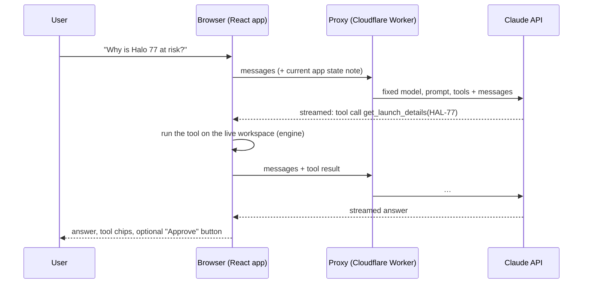

# The assistant ("Ask LaunchReady")

An AI assistant inside the app that answers questions about the plan: why a launch is at risk, what a supplier delay would do, which recovery option is best, how the rules work. It can also set up a what-if or a recovery approval, which the user applies with a click.

## Two modes

- **Free mode (default).** With no proxy and no key, the panel answers common questions straight from the plan with no AI and no cost (`src/agent/offline.ts`). It recognises what a question is about (a launch, platform, part or shipment) and what's asked (why, what if, how to recover, who acts, how it works), runs the same tools listed below, and writes the answer from their results, with the same tool chips and Approve / Apply buttons. Questions it can't place get a short help message rather than a guess. It's labelled "Free mode" in the panel.
- **Claude.** With the proxy configured (below), or a visitor's own API key ("use Claude with your own API key" in the panel), Claude answers open-ended questions using the same tools.

## How it works (Claude mode)



- **The model never computes.** Every number it states comes from a tool, and every tool wraps the same tested engine the views use (`src/agent/runAssistantTool.ts`). The system prompt requires it, and the tool results are visible in the panel (click a tool chip).
- **Tools run in the browser**, against the workspace as it is at that moment, including any disruption the user applied or option they approved. Each question starts with a short note of the current state.
- **It can't change the plan by itself.** `propose_what_if` and `propose_recovery` only return a description; the panel shows an Apply / Approve button, and the change goes through the same reducer (and Undo, and activity log) as a click anywhere else.
- **Tools** (`src/agent/assistant.ts`): `get_plan_overview`, `get_launch_details`, `get_platform_software`, `get_part_supply`, `find_shipments`, `simulate_what_if`, `get_recovery_options`, `explain_rules`, `propose_what_if`, `propose_recovery`. All use strict JSON schemas.
- **The loop** (`src/agent/loop.ts`): stream a call, run the requested tools, return all results in one message, repeat. It stops on an answer, a refusal (the partial turn is dropped from history), a cut-off tool call (never run), or after 8 tool rounds.

## Model and request settings

| Setting | Value | Why |
|---|---|---|
| Model | `claude-sonnet-5-5` | Chosen for cost; fast enough for chat. Change `ASSISTANT_MODEL` to use another model. |
| Thinking / effort | adaptive, `medium` | Multi-step tool use benefits from some thinking; `medium` keeps latency and cost down. |
| `max_tokens` | 8,000 | Answers are short; tool inputs are tiny. |
| Prompt caching | top-level `cache_control` | The system prompt and tools are a stable prefix, so repeated calls read them from cache. |
| Refusal fallback | `fallbacks: "default"` (beta `server-side-fallback-2026-07-01`) | If a request is declined, the API retries it on Anthropic's recommended model. |

## The proxy (`proxy/`)

A static site can't hold an API key, so the hosted site talks to a small Cloudflare Worker:

- **It owns the request.** It keeps only `messages` from the browser and rebuilds everything else from `src/agent/assistant.ts`, so the endpoint can't be used as a general Claude API with another prompt, model or tool set. Injected `system` turns are rejected.
- **Origin allowlist** (`ALLOWED_ORIGINS`), **per-IP rate limit** (20 model calls a minute; one question is usually 2–4 calls), **size caps** (256 KB body, 80 messages).
- **Errors come back in the API's shape**, so the browser SDK shows the right message (e.g. "Too many questions…" on 429).
- Tested in `tests/assistant-proxy.test.ts` without Cloudflare (the handler is a plain `Request → Response` function).

**Spending cap:** set a monthly spend limit on the API key's workspace in the Claude Console. That's the backstop the rate limit can't provide.

## Turning it on for the live site

1. **Anthropic:** create an API key in a dedicated Console workspace and give that workspace a monthly spend limit (for example $10).
2. **Cloudflare (free plan):** create an API token with the *Edit Cloudflare Workers* template and note your account ID.
3. **GitHub → Settings → Secrets and variables → Actions:**
   - Secrets: `ANTHROPIC_API_KEY`, `CLOUDFLARE_API_TOKEN`, `CLOUDFLARE_ACCOUNT_ID`.
   - Run the **Assistant proxy** workflow (Actions tab → Assistant proxy → Run workflow). It deploys the Worker and stores the key as a Worker secret. The log prints the Worker URL (`https://launchready-assistant.<subdomain>.workers.dev`).
   - Variable: `AGENT_PROXY_URL` = that URL.
4. Re-run the **CI** workflow on `main` (or push any change). The site is rebuilt with the proxy URL, and "Ask AI" works for every visitor.

Until then, visitors get free mode, and can switch to Claude with their own API key, which stays in that browser tab (sessionStorage) and goes only to `api.anthropic.com`.

## Running it locally

```bash
npm run dev                       # the panel asks for your API key
# or, against a local Worker:
npx wrangler dev --config proxy/wrangler.toml   # set ANTHROPIC_API_KEY in proxy/.dev.vars
VITE_AGENT_PROXY_URL=http://localhost:8787 npm run dev
```

## Cost

Each question is typically 2–4 model calls: roughly 5–15K input tokens (mostly the cached prompt and tools, plus tool results) and a few hundred output tokens. At Claude Sonnet 5.5 prices ($2 / $10 per million input / output tokens, cache reads $0.20), that's around 1–5 cents a question. Watch real usage in the Console.

## Tests

- `tests/assistant-tools.test.ts`: strict schemas; each tool's numbers match the engine; what-ifs and proposals never change the plan.
- `tests/assistant-loop.test.ts`: the loop with a scripted fake model (parallel tool results, tool errors, refusals, cut-off tool calls, round limit).
- `tests/assistant-proxy.test.ts`: request rebuilding, origins, methods, bad bodies, rate limit.
- `tests/assistant-offline.test.ts`: free mode's answers for each kind of question match the engine and never change the plan.
- `e2e/assistant.spec.ts`: the real browser path with scripted streamed responses (a question answered from the live plan; a proposed recovery applied only on click; error and retry), and free mode end to end with no API calls.

None of the tests call the real API. Before relying on the hosted assistant, ask it a handful of real questions and read its tool calls in the panel.
