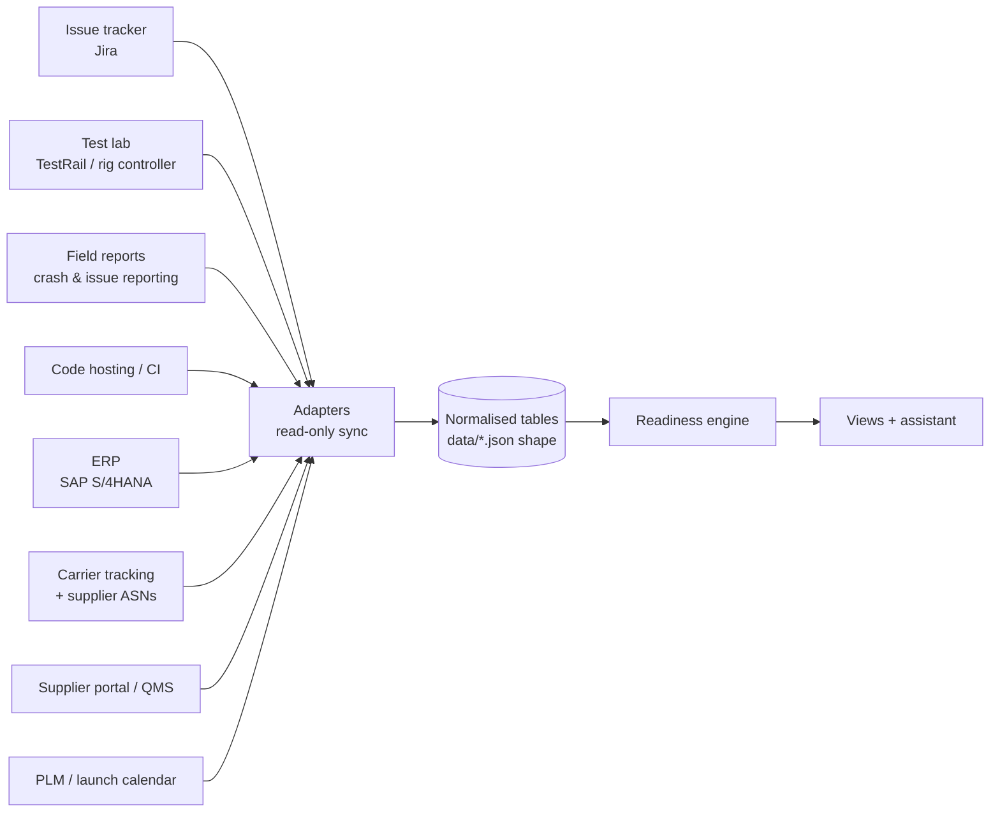

# Data sources and integrations

LaunchReady doesn't replace the systems teams already use; it reads them, joins them, and computes the launch verdict. This page names the system of record for each piece of data, how it would be fetched, and how fresh it needs to be. The demo runs on generated data (`npm run data:generate`); the adapters that would load real data are in `src/integrations/` and are tested against sample payloads in each system's own format. The **Data sources** view in the app runs them live.

| Data | System of record (examples) | How | Freshness | Adapter |
|---|---|---|---|---|
| Issues: severity, team, stage, comments, fix date | Issue tracker (Jira, Azure DevOps) | REST API + webhooks | Live; nightly full sync | `fromJiraIssue` |
| Test runs, failed steps, linked issues | Test lab management (TestRail, Xray, rig controller) | REST API; rigs post results | 15 min | `fromTestLabRun` |
| Customer reports: TVs affected, devices, version, user's words | Crash/issue reporting from TVs (Sentry or in-house) | Aggregated issue API | Hourly | `fromFieldReport` |
| Code submissions and team notes | Git hosting + CI (Gerrit, GitHub, Jenkins) + weekly team update | CI API + form | Hourly / weekly | — |
| Orders (shipments), stock, allocations, BOM | ERP (SAP S/4HANA, Oracle) | OData, read-only user | 30 min | `fromErpPurchaseOrder` |
| Shipment events, revised arrival dates | Carrier tracking aggregator (project44) + supplier ASNs (EDI 856) | Webhooks / EDI | Live | `fromCarrierTracking` |
| Supplier on-time rate, delay, defects, notes | Supplier portal and QMS (SAP Ariba, inspection records) | Export + per-lot results | Daily / monthly | — |
| Models, platforms, launch dates | PLM and launch calendar | API or maintained sheet | On change | — |

## Design choices

- **Read-only.** LaunchReady never writes back to these systems. An approved recovery action is a decision record; the change itself is made in the ERP by procurement.
- **Normalise at the edge.** Adapters convert each source into the same small set of tables the engine already reads (`src/engine/types.ts`). The engine, the views and the assistant don't know where data came from.
- **Freshness is visible.** Each source has a target refresh. In production every record would carry its sync time, and a view would flag a source that's behind (the demo shows one "data as of" date).
- **Commitments are explicit.** A fix date counts as committed only when the team sets the commitment field in the tracker (`customfield_10301` in the sample). Estimates are shown but don't move the quoted date.

## Is live integration realistic?

Yes, for a pilot. Each connection is a read-only API user and a scheduled job; the mapping work is the adapters, which exist here for the five most important formats. What a real deployment needs that a portfolio project can't have: access to the company's systems, agreed field conventions (which label holds the platform, which field holds the commitment), and a small backend to run the syncs and store the normalised tables.
